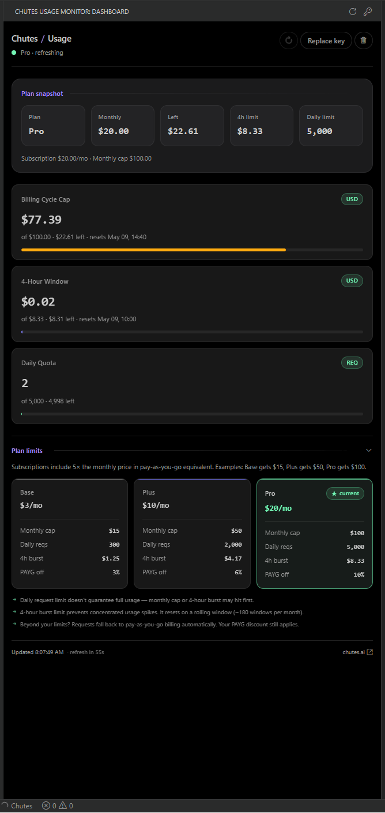

# Chutes Usage Monitor

Track Chutes usage, quotas, and rolling limits in a VS Code sidebar without leaving the editor.

[](https://github.com/TheStreamCode/chutes-usage-vscode/actions/workflows/ci.yml)
[](LICENSE)
[](https://marketplace.visualstudio.com/items?itemName=mikesoft.chutes-usage-vscode)



_Current dashboard rendered with synthetic, illustrative values._

Chutes Usage Monitor is a read-only VS Code extension for developers who run models through Chutes and
want billing context while they code. It shows subscription spend, rolling limits, daily requests, and
pay-as-you-go credit in an Activity Bar dashboard and an optional status bar summary, using only the
API key you provide.

This is an independent, unofficial third-party extension. It is not affiliated with, sponsored by, or
endorsed by Chutes.

## Install

Install `mikesoft.chutes-usage-vscode` from either registry:

```bash
code --install-extension mikesoft.chutes-usage-vscode
```

Alternatively, install it from [Open VSX](https://open-vsx.org/extension/mikesoft/chutes-usage-vscode)
if your editor uses that registry.

## Quick start

1. Open the Command Palette and run **`Chutes Usage Monitor: Set API Key`**.
2. Paste a Chutes API key; it is stored in VS Code SecretStorage.
3. Open the **Chutes Usage Monitor** view from the Activity Bar to see the dashboard.

The dashboard refreshes on the configured interval, when it becomes visible again, and when VS Code
regains focus. Run **`Chutes Usage Monitor: Refresh`** to refresh immediately.

## Features

- Sidebar dashboard for billing-cycle, rolling four-hour, and daily request usage.
- Plan context and pay-as-you-go credit with visible low-credit and no-credit warnings.
- Optional status bar summary for quick checks without opening the dashboard.
- Manual and automatic refresh, including refresh on view visibility and window focus.
- Native Light, Dark, and High Contrast theme support, with keyboard and screen-reader accessibility.
- Read-only access to your own account data; the extension never mutates anything on Chutes.
- Secure API-key storage in VS Code SecretStorage, with no local usage history.
- A locked-down webview with a per-load content security policy nonce.

## Requirements

- VS Code 1.103.0 or newer, or a compatible editor that installs from Open VSX.
- A Chutes account and an API key that can read your own usage data.
- Network access to `https://api.chutes.ai`.

## Configuration

| Setting                                    | Purpose                                        | Default |
| ------------------------------------------ | ---------------------------------------------- | ------- |
| `chutesUsageVscode.refreshIntervalSeconds` | Refresh interval in seconds.                   | `60`    |
| `chutesUsageVscode.showStatusBar`          | Show the Chutes Usage Monitor status bar item. | `true`  |

Both settings apply immediately; no window reload is required.

| Command                                | Purpose                              |
| -------------------------------------- | ------------------------------------ |
| `Chutes Usage Monitor: Open Dashboard` | Focus the dashboard view.            |
| `Chutes Usage Monitor: Refresh`        | Fetch a fresh snapshot now.          |
| `Chutes Usage Monitor: Set API Key`    | Store or replace the Chutes API key. |
| `Chutes Usage Monitor: Remove API Key` | Delete the stored key.               |

## Privacy and security

The API key is stored with VS Code SecretStorage and is used only to request your own usage data. The
extension keeps no local history of usage data; the webview persists only whether the Plan Limits
section is collapsed, never an account snapshot. It performs best-effort cleanup of its extension
storage on uninstall and reports no telemetry.

The webview loads its bootstrap as an ES module with a per-load content security policy nonce, and
external links open only through an allowlist. Usage figures may lag behind live requests; when daily
quota data cannot be verified reliably, the dashboard shows `--` instead of a misleading `0`. See
[`SECURITY.md`](SECURITY.md) for vulnerability reporting.

## Troubleshooting

### The dashboard asks for an API key

Run **`Chutes Usage Monitor: Set API Key`**, paste a valid key, then run
**`Chutes Usage Monitor: Refresh`**.

### The sidebar is blank

Update the extension to the latest release, reload the VS Code window, and reopen the view from the
Activity Bar. A webview bootstrap regression in an older release could prevent the dashboard from
rendering at all.

### The sidebar icon looks different from the Marketplace icon

That is expected. The Activity Bar icon is a dedicated single-color SVG that follows VS Code icon
guidelines, while the Marketplace listing uses the full-artwork PNG icon.

### Refresh errors or `--` values

Verify that the key is still valid and that the Chutes API is reachable, then refresh. Chutes quota
metering can lag behind live traffic, so the extension shows `--` when a value cannot be verified
instead of a possibly wrong `0`. While the extension host stays active, a temporary API failure may
keep the last successful snapshot visible; the snapshot itself is never persisted.

### Quota rows look incomplete

API response shapes can change. Refresh the dashboard, compare again after a short delay, and when
reporting the issue include a redacted sample payload that keeps field names and numeric values.

## Development

Requires Node.js 22.17.0 (see `.nvmrc`) and npm. The lockfile is authoritative.

```bash
git clone https://github.com/TheStreamCode/chutes-usage-vscode
cd chutes-usage-vscode
npm ci
npm run check
```

`npm run check` compiles the extension host and webview, runs the `node:test` suites, and audits
dependencies. `npm run package` builds the VSIX, and `npm run preflight` runs both. Press `F5` in VS
Code to launch an Extension Development Host.

## Support

Ask setup and usage questions in
[GitHub Discussions](https://github.com/TheStreamCode/chutes-usage-vscode/discussions) and report
reproducible defects in [GitHub Issues](https://github.com/TheStreamCode/chutes-usage-vscode/issues).
See [`SUPPORT.md`](SUPPORT.md) and [`docs/troubleshooting.md`](docs/troubleshooting.md) for more.

## Contributing

See [`CONTRIBUTING.md`](CONTRIBUTING.md). Pull requests must pass the required CI checks.

## License

MIT — see [`LICENSE`](LICENSE). Trademark and provider notices are in [`NOTICE`](NOTICE).

---

Maintained by [Michael Gasperini (Mikesoft)](https://mikesoft.it).
If this project is useful to you, consider [sponsoring its maintenance](https://github.com/sponsors/TheStreamCode).
